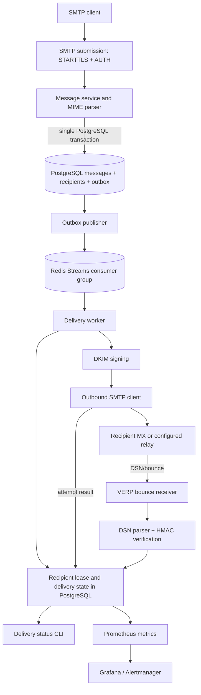

# MailForge architecture

## Purpose and boundary

MailForge is an SMTP submission and outbound-delivery engine. Its primary responsibility is to accept a message from an authorized submitter, persist the message and its recipients, deliver each recipient independently, and retain enough state to explain retries and outcomes.

It is not a mailbox store or mail client. There is no IMAP/POP3 server, inbox UI, message search product, or end-user mailbox synchronization layer.

## High-level flow

## Component responsibilities

### SMTP submission and message intake

`cmd/smtp-submission` starts the authenticated submission server. TLS is required before AUTH. The server authenticates a stored SMTP credential, checks sender authorization and server limits, and passes accepted message data to the message service.

`cmd/smtp` is a separate unauthenticated listener bound to loopback for trusted local injection and development. It is not a public submission endpoint.

The message service parses and validates message content, stores the raw message and parsed metadata, creates recipient rows, and writes the initial delivery event to the outbox in the same database transaction. This prevents an accepted message from being committed without its corresponding durable delivery intent.

### PostgreSQL and transactional outbox

PostgreSQL is the durable source of truth for message data, recipient state, delivery attempts, status events, credentials, sending-domain verification, quota usage, suppression records, DSN idempotency, and outbox events.

The publisher claims due outbox rows using database lease fields, publishes them to Redis Streams, and records publication outcomes. Dead events can be inspected and replayed through the outbox administration command.

### Redis Streams and workers

Redis Streams distributes work across delivery consumers. Consumer groups provide pending-entry tracking and reclamation after a consumer stops. Redis is the work-distribution layer; PostgreSQL retains recipient state and retry scheduling.

A worker obtains a recipient lease before performing outbound SMTP. The lease prevents overlapping workers from sending the same recipient concurrently. The worker records the attempt and the SMTP response, updates recipient status, and acknowledges the Redis event when processing is complete.

### Outbound SMTP and delivery outcomes

Each recipient is handled independently. A successful SMTP response is recorded as `delivered` (meaning the next-hop SMTP server accepted the message). Temporary failures become `deferred` and are rescheduled according to the retry policy. Permanent failures become `bounced` and are not retried automatically.

If the connection is lost after the remote server may have accepted DATA but before MailForge receives the final response, the outcome is ambiguous. MailForge records `unknown` and avoids an automatic retry that could send a duplicate. SMTP does not offer a universal exactly-once guarantee.

### DKIM and bounce processing

The delivery worker can DKIM-sign outbound messages using configured key material. The keyset mechanism supports active and retiring selectors so DNS can publish overlapping public keys during rotation.

VERP bounce addresses correlate DSNs with the original recipient. The bounce receiver validates the HMAC token, parses the DSN, records processed reports idempotently, updates recipient outcomes, and creates suppression records for hard bounces.

### Observability

Application processes expose Prometheus metrics. Prometheus scrape configuration and alert rules are in `deployments/prometheus/`. Provisioned Grafana dashboards are in `deployments/grafana/`. Local Docker Compose also includes Mailpit for safe SMTP testing.

## Durable data model

The ordered migrations in `migrations/` currently create or evolve these main entities:

| Table | Role |
|---|---|
| `messages` | Stored message envelope, raw content, and parsed metadata |
| `recipients` | Independent state, retry schedule, lease, and delivery diagnostics per recipient |
| `delivery_attempts` | One row per outbound delivery attempt and its outcome |
| `delivery_status_events` | Append-oriented recipient status transition history |
| `outbox_events` | Durable work publication, leases, retries, and dead-letter state |
| `smtp_credentials` | SMTP AUTH credential records |
| `smtp_sending_domains` | Sending-domain ownership and DNS verification |
| `smtp_submission_usage` | Account/IP quota usage windows |
| `outbox_event_replays` | Audit/idempotency records for operator replay |
| `recipient_suppressions` | Addresses blocked after qualifying bounce outcomes |
| `processed_dsn_reports` | DSN idempotency and processing records |

The exact columns and constraints are defined by the SQL migrations; treat those files as the schema source of truth.

## Recipient state model

The principal recipient statuses are:

- `pending`: accepted and eligible for a first delivery attempt.
- `delivering`: a worker owns the active delivery lease.
- `deferred`: a temporary failure occurred and a future retry is scheduled.
- `delivered`: the next-hop SMTP server accepted the message.
- `bounced`: a permanent SMTP failure or qualifying hard-bounce DSN was recorded.
- `unknown`: the remote delivery outcome could not be determined safely.
- `suppressed`: the address is blocked by an existing suppression rule (where represented by the active schema version).

`delivery_attempts` and `delivery_status_events` provide the diagnostic history behind the current recipient row.

## Consistency and failure-handling principles

1. PostgreSQL is authoritative for message and recipient state; Redis is not the only copy of delivery intent.
2. Message/recipient creation and the initial outbox event are committed together.
3. Outbox publishing and Redis consumption are retryable and idempotency-aware.
4. Recipient leases protect the outbound SMTP operation from concurrent processing.
5. Temporary and permanent SMTP responses have different state transitions.
6. Ambiguous SMTP results are not automatically replayed as if failure were certain.
7. DSN processing is idempotent and uses a signed VERP correlation token.

These guarantees reduce duplicate work and lost work, but they do not transform SMTP into an exactly-once transport.
